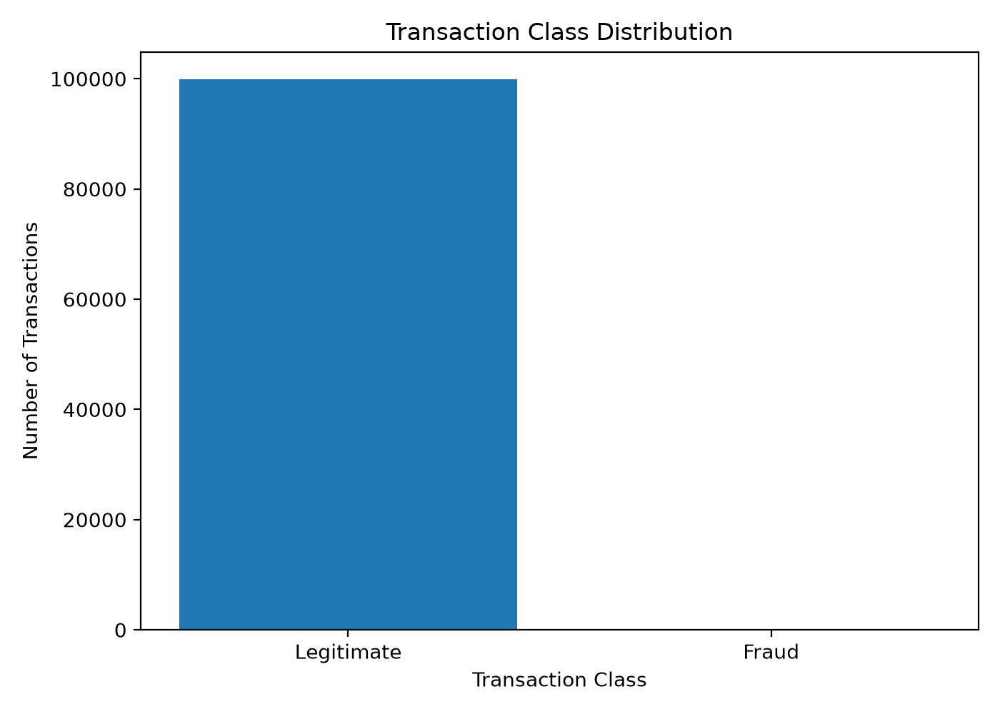
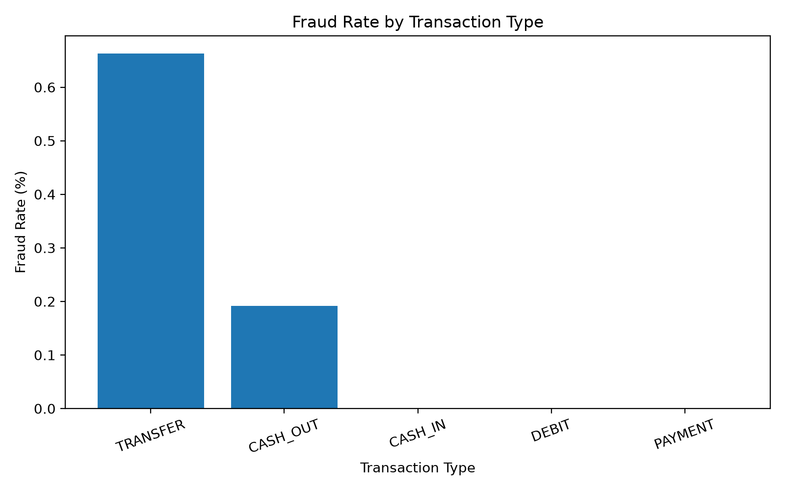

# 💳 Digital Transaction Fraud Detection

<p align="center">

**Machine Learning based fraud-risk prediction for digital financial transactions**

</p>

<p align="center">


</p>

---

## 📌 Project Overview

Financial transaction fraud is a highly imbalanced machine learning problem where fraudulent transactions represent only a very small fraction of total transactions.

This project develops an end-to-end machine learning system that analyzes transaction characteristics and behavioral patterns to identify potentially fraudulent transactions.

The system combines:

- Behavioral feature engineering
- Categorical encoding
- Random Forest classification
- Fraud-focused model evaluation
- Model serialization using Joblib
- Interactive Streamlit deployment

The final application allows users to enter transaction details and receive a **fraud-risk prediction and probability estimate**.

---

## 🎯 Key Features

- 🔍 Transaction-level fraud prediction
- 📊 Behavioral feature engineering
- 🌲 Random Forest classification
- ⚖️ Handles highly imbalanced fraud data
- 📈 Precision, Recall and F1-score evaluation
- 🧠 Probability-based fraud-risk estimation
- 🖥️ Interactive Streamlit interface
- 💾 Serialized production-ready model

---

# 📊 Dataset Analysis

The dataset contains transaction-level information including:

| Feature | Description |
|---|---|
| `step` | Time step of the transaction |
| `type` | Transaction type |
| `amount` | Transaction amount |
| `oldbalanceOrg` | Sender balance before transaction |
| `newbalanceOrig` | Sender balance after transaction |
| `oldbalanceDest` | Receiver balance before transaction |
| `newbalanceDest` | Receiver balance after transaction |
| `isFraud` | Fraud label |

### Transaction Class Distribution



The dataset is highly imbalanced, with fraudulent transactions forming only a very small fraction of the observations.

This makes metrics such as **precision, recall and F1-score** more informative than accuracy alone.

---

## 🔎 Fraud Patterns

### Fraud Rate by Transaction Type



The analysis shows that fraudulent transactions are concentrated in specific transaction types rather than being uniformly distributed across the dataset.

This motivated the use of transaction type as an important categorical feature.

---

# 🧠 Feature Engineering

Instead of feeding only raw transaction variables into the model, behavioral features were created to capture transaction context.

### Engineered Features

**Amount-to-Sender-Balance Ratio**

```text
amount_to_sender_balance =
transaction_amount / (sender_balance + 1)